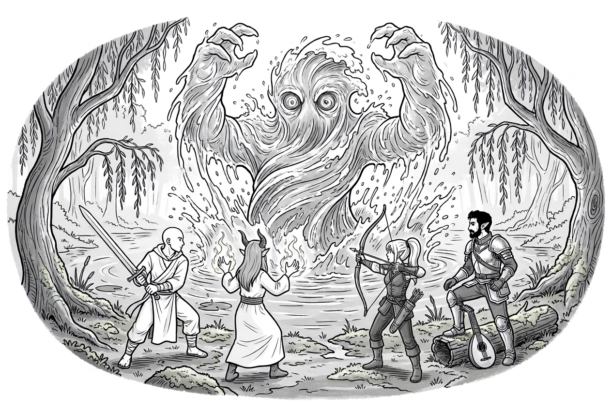

# Chapter 1: The Pickled Egg and the Sinking Town

The morning after High Queen Alicia's grand royal feast, the streets of Caer Callidyrr were bright and bustling. Most heroes who had just saved the prince and banished an ancient monster would have stayed in the palace to enjoy velvet pillows and silver platters. 

Instead, the newly named Keepers of Mordrin found themselves standing outside a crooked wooden building in the Low Quarter. Above the door hung a squeaky sign painted with a lopsided green egg: *The Pickled Egg*.

"Are we sure about this place?" Eryneth asked, wrinkling her nose as they stepped inside. The floorboards were sticky, the lanterns were dim, and a giant glass jar full of murky green pickled eggs sat on the counter.

Behind the bar stood a lanky, nervous-looking half-elf wiping a mug with a gray rag. He jumped when he saw the four armed adventurers walk in. "W-welcome to *The Pickled Egg*!" he stammered. "I'm Aribert. If you're here to break tables, please pay for them first!"

"Fear not, my good man!" Caryndal announced, sweeping off his feathered hat with a dramatic bow. "Today is your lucky day! You are looking at the Keepers of Mordrin—official champions of High Queen Alicia—and we have chosen your humble tavern as our grand headquarters!"

"And our marketing partner," Szeth added, stepping up to the bar with a very serious expression. He had spent the whole morning talking with Caryndal about how famous heroes needed a proper reputation. "If people need monsters fought, they need to know our name. Caryndal and I have a plan. Always Be Branding And Bartering."

Aknemeia giggled, hopping onto a tall barstool. "Did you just make that up?"

"It is sound strategy," Szeth replied firmly. "First, we need an emblem."

"Leave that to me," Aknemeia said with a grin. She pulled a square of parchment onto the counter, traced her finger across the paper, and let a tiny, controlled spark of fire magic dance along her nail. In seconds, she had scorched a striking, bold silhouette of a raven with outstretched wings, surrounded by a ring of little flames.

"Magnificent!" Caryndal gasped, holding the drawing up to the lantern light. "We will take this to a tailor at once and have dozens of embroidered patches stitched! Every hero, guard, and villager on the island will want one!"

Just then, a loud *SQUAWK!* echoed through the tavern. Szeth opened the small wooden cage at his belt, and Mordrin the raven fluttered out. The grumpy black bird ignored everyone, flew straight up to a wooden rafter right above Aribert's pickled egg jar, and glared down like a tiny king.

Szeth looked up at the bird and sighed. "We cannot keep taking Mordrin into dark caves and monster fights. He is just an ordinary bird, and it is too dangerous for him." He turned to the tavern owner and placed a heavy pouch of gold coins on the counter. "Aribert, we are leaving Mordrin in your care. He will live here as the official mascot of the Keepers of Mordrin."

Aribert stared at the grumpy raven, then at the pouch of gold. "You want me to babysit a bird?!"

"Only the finest seeds and biscuit crumbs for him," Szeth instructed solemnly. "And if anyone asks about the raven, tell them to hire the Keepers of Mordrin."

Before Aribert could argue, Mordrin let out another loud *CAW!* and knocked a wooden coaster onto Aribert's head. The half-elf sighed and pocketed the gold. "Fine. Just don't let him near the pickle jar."

---

After dropping off Aknemeia's drawing at a tailor shop to have their patches made, the four heroes walked up to the Wolf Quarter to report to Captain Daedra of the Royal Guard. 

Captain Daedra, a stern woman in polished chainmail, unrolled a large map of the island across her desk. "The High Queen told me I could count on you four," she said briskly. "Right now, my guards are stretched thin, and I have two strange problems that need investigating."

She tapped a spot on the western side of the map. "First, in the small village of Tuathair—where many of our halfling and gnome citizens live—buildings have been mysteriously sinking straight into the ground. Mayor Deddwoc has offered a reward to anyone who can stop the sinkholes before the whole town disappears."

Then her finger moved north, toward the jagged peaks of the Fairheight Mountains. "Second, we haven't heard a single word from the dwarven mining town of Copperwood in two weeks. Even the supply wagons we sent north haven't returned."

Eryneth studied the map carefully. "Tuathair is closer. If we ride west and help the villagers with the sinkholes first, we can head straight north to Copperwood right after."

"A sensible plan," Captain Daedra nodded. "Good luck, Keepers."

---

By late afternoon, the heroes arrived in the charming hillside village of Tuathair. Everything in the town was built for halflings and gnomes—which meant Eryneth and Aknemeia fit right in, while Szeth and Caryndal had to duck under every single signpost.

Right in the middle of Main Street, they saw the problem for themselves. Three different buildings—a market stall, a second-hand shop, and a cozy tavern with a sign reading *The Giant Pint*—had collapsed into deep, crumbling sinkholes in the dirt!

A cheerful halfling with a big white apron trotted over to greet them. "Careful near the edge, tall folks! I'm Hormunt. That used to be my inn down in that hole." He pointed proudly across the street to a freshly painted building with an even bigger sign. "So I opened a new one across the road! Welcome to *The Gianter Pint*!"

After speaking with Mayor Deddwoc at the town hall, the Keepers spent the night at *The Gianter Pint*—though Szeth's feet hung two feet off the end of his halfling-sized bed. The next morning, Hormunt served a towering platter of warm, golden, buttery breakfast biscuits.

Aknemeia took one bite and her golden eyes went wide with joy. "Oh, these are amazing! Szeth, try one! These are a hundred times better than those rocks we ate on the ship!"

Even Szeth had to nod in agreement as he stuffed two biscuits into his pockets for later. "While we eat," Eryneth said, looking out the window toward the thick woods west of town, "notice how the sinkholes form a straight line? They started at the western edge of the village. And Hormunt mentioned the lake in the western woods turned foul a few weeks ago."

"Then the western lake is where we will find our culprit," Caryndal declared, strumming a heroic chord on his lute.

The woods west of Tuathair quickly grew tangled and dark. Before long, the solid ground turned into squelching mud, and a terrible smell—like rotten eggs and sour swamp water—filled the air. Stepping into a gloomy clearing, the heroes found a wide lake covered in bubbling green scum.

"Something isn't right," Eryneth whispered, nocking an arrow to her bow. "The water is moving against the wind."

Suddenly, the center of the lake bulged upward! With a deafening *SPLASH*, a massive wave of murky green water rose up like a living giant. Two swirling whirlpools formed where its eyes should be, and it swung a club-sized arm of crashing water straight at the heroes!

"Look out!" Szeth shouted, leaping forward with the heavy Beastslayer greatsword he had earned on Mintarn. He slashed through the watery arm, sending spray flying in every direction, but the water monster simply reformed and surged forward again, trying to sweep Caryndal off his feet.

"My boots! Watch the leather!" Caryndal yelped, scrambling back onto a mossy log.

"Let's see how it likes steam!" Aknemeia called out. She hurled twin bolts of bright orange fire straight into the creature's chest. The flames hit with a loud *HISS*, boiling away a huge chunk of the monster's watery body.

Eryneth spotted a swirling core of magic spinning inside the creature's chest and loosed two silver-tipped arrows in rapid succession. *Thwack! Thwack!* The arrows disrupted the spinning current, making the giant water monster wobble and slump.

"Now, Caryndal!" Szeth yelled, bracing his boots in the mud and driving the flat of his greatsword against the surging wave to hold it back.

Caryndal leaped to the end of the log, raised his lute high, and struck a booming, magical chord. "*Thunderwave!*"

A shockwave of pure sound blasted across the clearing—*BOOOOM!* The living wave shattered into a million harmless droplets, raining down over the trees and splashing into the mud.

Aknemeia brushed a wet lock of hair out of her face, grinning. "Well, that wakes you up faster than biscuits."

"Look there," Eryneth said, pointing toward the far bank of the lake. Where the water level had dropped after the battle, a dark opening was now visible beneath the twisted roots of an ancient willow tree—a freshly dug tunnel leading deep underground.

Szeth wiped the water from his sword and peered into the dark hole. "Whatever is digging under Tuathair is down there. Let's go."