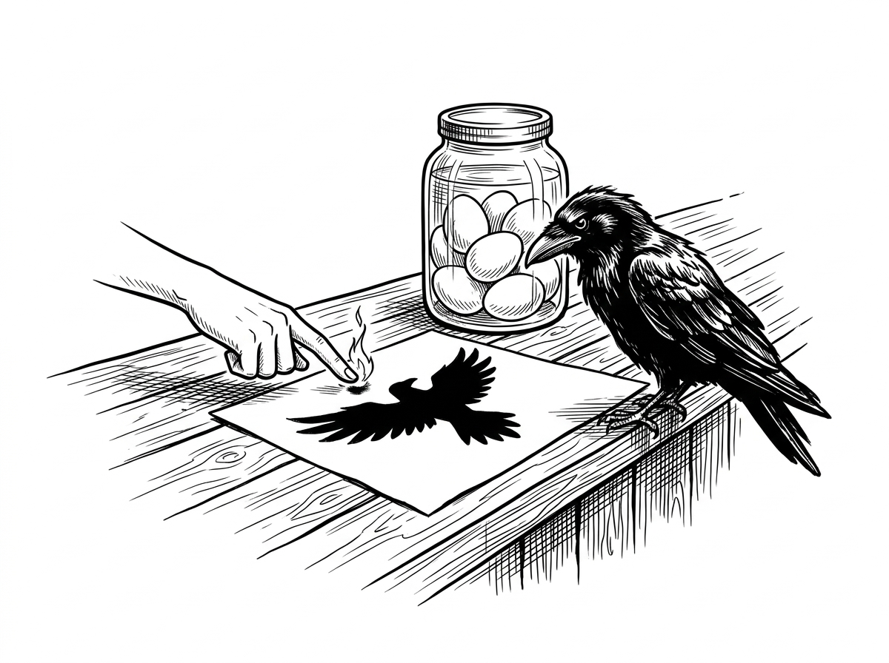

# Chapter 1: Pickled Eggs and Sinking Towns

The morning after High Queen Alicia's grand royal feast, the streets of Caer Callidyrr were bright and bustling. Colorful banners fluttered from the rooftops as townsfolk celebrated the safe return of Prince Gregory and the defeat of the ancient monster Kazgoroth. The night before, the four heroes who had saved him—now officially known as the Keepers of Mordrin—had slept in the royal palace on velvet pillows and dined off silver platters.

Today, however, they were back on their feet, strolling down the wide cobblestone avenue that led away from the castle gates.

"You have to admit, it makes a marvelous tale," Caryndal said, strumming a cheerful chord on his lute as they walked. "Just weeks ago, the four of us were complete strangers on a ship when Ulfrik's raiders attacked! Next thing you know, we're rescuing old Wizard Suhlur from a cursed crystal shard, sailing to the pirate isle of Mintarn, and banishing a giant monster in the middle of a forest!"

Eryneth looked up at the royal banners waving overhead and smiled warmly. "We really did accomplish something special," she said, her voice full of quiet pride. "The Queen trusted us with her son's life, and we brought him home. Now that we're official champions of the realm, we have a duty to keep helping the people of these islands."

Beside her, Szeth paused near the edge of the market square. A small boy in patched, threadbare clothes was sitting on a crate by an alleyway, watching the bakers' carts with wide, hungry eyes. Without making a fuss, Szeth reached into the pocket of his white robe, pulled out a handful of sugared fruit candies he had saved from the royal banquet table, and held them out.

"Here," Szeth said simply. "The palace had way too many of these."

The boy's face lit up with a huge grin. He scooped up the candies, whispered a quick thank-you, and darted off down the lane.

"Well," Caryndal said, adjusting his armored shoulder guard as Szeth rejoined them, "if we are to be proper champions, we need to know where the next great adventure awaits! Perhaps we should return to the palace library?"

Aknemeia snorted, a mischievous spark dancing in her golden eyes. Growing up in Baldur's Gate with a father who ran a shadowy network of informants, she knew a thing or two about how cities really worked. "Please! Fancy palace halls only tell you half the story," she said, pointing down a narrow, winding staircase that led toward the docks and the Low Quarter. "If we want all the juicy information—and a place where nobody minds a little bit of noise—we need to check out the Low Quarter!"

Following Aknemeia's lead through the twisting alleys, the Keepers soon found themselves standing outside a crooked wooden tavern. Above the door hung a squeaky sign painted with a lopsided green egg: *The Pickled Egg*.

"Are we sure about this place?" Eryneth asked, wrinkling her nose as they stepped inside. The floorboards were sticky, the lanterns were dim, and a giant glass jar full of murky green pickled eggs sat on the counter.

Behind the bar stood a lanky, nervous-looking half-elf wiping a mug with a gray rag. He jumped when he saw the four armed adventurers walk in. "W-welcome to *The Pickled Egg*!" he stammered. "I'm Aribert. If you're here to break tables, please pay for them first!"

"Fear not, my good man!" Caryndal announced, sweeping a dramatic bow. "Today is your lucky day! You are looking at the Keepers of Mordrin—official champions of High Queen Alicia—and we have chosen your humble tavern as our grand headquarters!"

"And our marketing partner," Szeth added, stepping up to the bar with a very serious expression. While he was at it, he unlatched the small wooden cage at his belt so Mordrin the raven could hop out onto the counter beside the pickle jar and stretch his wings. "If people need monsters fought, they need to know our name. Caryndal and I have a plan. Always Be Branding And Bartering."

Aknemeia giggled, hopping onto a tall barstool. "Did you just make that up?"

"It is sound strategy," Szeth replied firmly. "First, we need an emblem."

"Leave that to me," Aknemeia said with a grin. She pulled a square of parchment onto the counter, traced her finger across the paper, and let a tiny, controlled spark of fire magic dance along her nail. As Mordrin leaned in to inspect her work with a sharp black eye, she scorched a striking, bold silhouette of a raven with outstretched wings onto the page.

"Magnificent!" Caryndal gasped, holding the drawing up to the lantern light. "We will take this to a tailor at once and have dozens of embroidered patches stitched! Every hero, guard, and villager on the island will want one!"

Satisfied with his portrait, Mordrin let out a loud *SQUAWK!*, fluttered straight up to a wooden rafter above the bar, and glared down like a tiny king.

Szeth looked up at the bird and sighed. "I suppose Mordrin will have to stay somewhere safe. We can't take him with us on our wild, dangerous adventures as the Queen's new number-one hero team. It's just too dangerous for a majestic bird like him." He turned to the tavern owner and placed a heavy pouch of gold coins on the counter. "Aribert, we are leaving Mordrin in your care. He will live here as the official mascot of the Keepers of Mordrin."

Aribert stared at the grumpy raven, then at the pouch of gold. "You want me to babysit a bird?! He'll make a mess in here!"

"I'm sure nobody will be able to tell the difference. And yes, only the finest seeds and biscuit crumbs for him," Szeth instructed solemnly. "And if anyone asks about the raven, tell them to hire the Keepers of Mordrin."

Before Aribert could argue, Mordrin let out another loud *CAW!* and knocked a wooden coaster onto Aribert's head. The half-elf sighed and pocketed the gold. "Fine. Just don't let him near my pickle jars."

---

After Aribert pointed them toward a local tailor shop to drop off Aknemeia's drawing—and tipped them off that the Royal Guard was looking for help—the four heroes walked up to the Wolf Quarter to report to Captain Daedra. 

Captain Daedra, a stern woman in polished chainmail, unrolled a large map of the island across her desk. "The High Queen told me I could count on you four," she said briskly. "Right now, my guards are stretched thin, and I have two strange problems that need investigating."

She tapped a spot on the western side of the map. "First, in the small village of Tuathair—where many of our halfling and gnome citizens live—buildings have been mysteriously sinking straight into the ground. Mayor Deddwoc has offered a reward to anyone who can stop the sinkholes before the whole town disappears."

Then her finger moved north, toward the jagged peaks of the Fairheight Mountains. "Second, we haven't heard a single word from the dwarven mining town of Copperwood in two weeks. Even the supply wagons we sent north haven't returned."

Eryneth studied the map carefully. "Tuathair is closer. If we travel west and help the villagers with the sinkholes first, we can head straight north to Copperwood right after."

"A sensible plan," Captain Daedra nodded. "Good luck, Keepers."

---

By late afternoon, the heroes arrived in the charming hillside village of Tuathair. Everything in the town was built for halflings and gnomes—which meant lots of ducking beneath signposts for everyone.

Right in the middle of Main Street, they saw the problem for themselves. The remnants of three different buildings—a market stall, a second-hand shop, and a tavern—had collapsed into deep, crumbling sinkholes in the dirt! The only thing that remained of the tavern was its sign, sticking up just out of the hole. It read "*The Giant Pint*."

A cheerful halfling with a big white apron trotted over to greet them. "Careful near the edge, tall folks! I'm Hormunt. That used to be my inn down in that hole." He pointed proudly across the street to a freshly painted building with an even bigger sign. "So I opened a new one. Welcome to *The Gianter Pint*! Mayor Deddwoc is waiting to meet you inside."

Ducking through the low front doorway of *The Gianter Pint*, the Keepers found Mayor Deddwoc—a round-faced gnome wearing a formal velvet sash—poring over a village map at a corner table while Hormunt hurried over with mugs of spiced apple cider. "Thank goodness the High Queen sent help!" Mayor Deddwoc exclaimed, dabbing his forehead with a handkerchief. "It started three weeks ago at the western edge of town. First, Berbalin's fruit stall dropped straight into the dirt. A week later, Turbin's second-hand shop went down, and two days ago, Hormunt's old tavern sank right after breakfast! I'm certain all these holes share a common cause, but none of us have the faintest idea where to start looking."

"And that's not the only strange thing," Hormunt chimed in, setting down the cider mugs. "Right around the time the first hole opened up, the lake in the woods west of town turned sour and bubbly. Our fishers haven't caught a single fish out there in weeks, and the brush has grown so thick you can barely walk the trail!"

The Keepers promised to investigate at first light and spent the night at *The Gianter Pint*—though Szeth's feet hung two feet off the end of his halfling-sized bed. The next morning, Hormunt served a towering platter of warm, golden, buttery breakfast biscuits.

Aknemeia took one bite and her golden eyes went wide with joy. "Oh, these are amazing! Szeth, try one! These are a hundred times better than those rocks we ate on the ship!"

Szeth nodded in agreement as he stuffed two biscuits into his pockets for later. "While we eat," Eryneth said, looking out the window toward the thick woods west of town, "notice how the sinkholes form a straight line? They started at the western edge of the village. And Hormunt mentioned the lake in the western woods turned foul a few weeks ago."

"Then the western lake is where we will find our culprit," Caryndal declared, strumming a heroic chord on his lute.

The woods west of Tuathair quickly grew tangled and dark. Before long, the solid ground turned into squelching mud, and a terrible smell—like rotten eggs and sour swamp water—filled the air. Stepping into a gloomy clearing, the heroes found a wide lake covered in bubbling green scum.

"Something isn't right," Eryneth whispered, nocking an arrow to her bow. "The water is moving against the wind."

Suddenly, the center of the lake bulged upward! With a deafening *SPLASH*, a massive wave of murky green water rose up like a living giant. Two swirling whirlpools formed where its eyes should be, and it swung a club-sized arm of crashing water straight at the heroes!

"Look out!" Szeth shouted, leaping forward with the heavy Beastslayer greatsword he had earned on Mintarn. He slashed through the watery arm, sending spray flying in every direction, but the water monster simply reformed and surged forward again, trying to sweep Caryndal off his feet. Caryndal yelped, scrambling back onto a mossy log.

"Let's see how it likes steam!" Aknemeia called out. She hurled twin bolts of bright orange fire straight into the creature's chest. The flames hit with a loud *HISS*, boiling away some of the monster's watery form, though less than Aknemeia had hoped.

Eryneth spotted the swirling core of magic spinning inside the creature's chest and loosed two silver-tipped arrows in rapid succession. *Splash! Splash!* The arrows tore straight through the creature, briefly disrupting its internal current. It wobbled a bit, but recovered quickly. Eryneth frowned.

"Any ideas, Caryndal?" Szeth yelled, bracing his boots in the mud and driving the flat of his greatsword against the surging wave to hold it back.

"Perhaps some theme music!" shouted Caryndal, leaping to the end of the log. He raised his lute high and struck a booming, magical chord. A shockwave of pure sound blasted across the clearing—*BOOOOM!* The living wave shattered into a million harmless droplets, raining down over the trees and splashing into the mud.

Aknemeia brushed a wet lock of hair out of her face, grinning. "Well, that wakes you up faster than biscuits."

"Look there," Eryneth said, pointing toward the far bank of the lake. Where the water level had dropped after the battle, a dark opening was now visible beneath the twisted roots of an ancient willow tree—a freshly dug tunnel leading deep underground.

Szeth, whose white robes were now more muck-colored, wiped the water from his sword and peered into the dark hole. "Whatever is digging under Tuathair is probably down there. Let's go."
