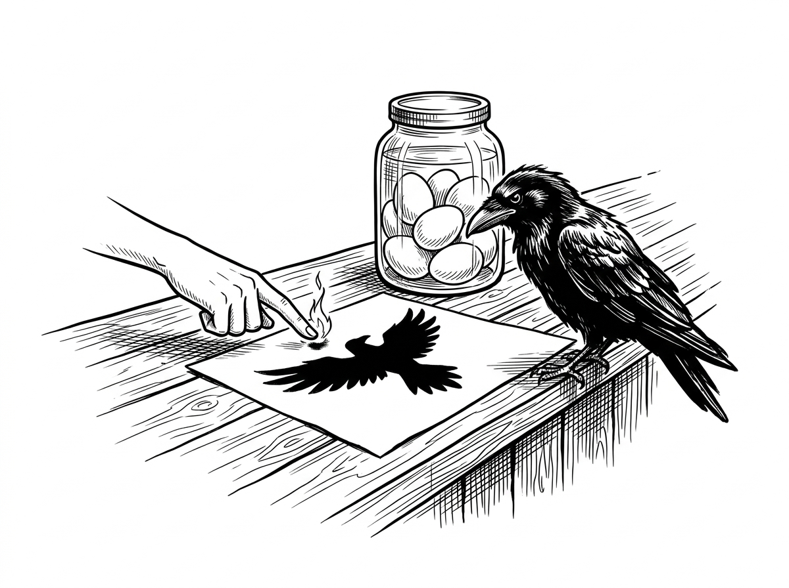

# Chapter 1: Pickled Eggs

The morning after High Queen Alicia's grand royal feast, the streets of Caer Callidyrr were bright and bustling. Colorful banners fluttered from the rooftops as townsfolk celebrated the safe return of Prince Gregory and the defeat of the ancient monster Kazgoroth. The night before, the four heroes who had saved him—now officially known as the Keepers of Mordrin—had slept in the royal palace on velvet pillows and dined off silver platters.

Today, however, they were back on their feet, strolling down the wide cobblestone avenue that led away from the castle gates.

"You have to admit, it makes a marvelous tale," Caryndal said, strumming a cheerful chord on his lute as they walked. "Just weeks ago, the four of us were complete strangers on a ship when Ulfrik's raiders attacked! Next thing you know, we're rescuing old Wizard Suhlur from a cursed crystal shard, sailing to the pirate isle of Mintarn, and banishing a giant monster in the middle of a forest!"

Eryneth looked up at the royal banners waving overhead and smiled warmly. "We really did accomplish something special," she said, her voice full of quiet pride. "The Queen trusted us with her son's life, and we brought him home. Now that we're official champions of the realm, we have a duty to keep helping the people of these islands."

Beside her, Szeth paused near the edge of the market square. A small boy in patched clothes was sitting on a crate, watching the bakers' carts with wide, hungry eyes. Without making a fuss, Szeth reached into the pocket of his white robe, pulled out a handful of sugared fruit candies and a scone he had saved from the royal banquet table, and held them out.

"Here," Szeth said. "The palace had way too many of these."

The boy's face lit up with a huge grin. He scooped up the food, said a quick thank-you, and darted off down the lane.

"Well," Caryndal said, smiling and adjusting his armored shoulder guard as Szeth rejoined them, "if we are to be proper champions, we need to know where the next great adventure awaits! Perhaps we should return to the palace library?"

Aknemeia snorted, a mischievous spark dancing in her golden eyes. Growing up in Baldur's Gate with a father who ran a shadowy network of informants, she knew a thing or two about how cities really worked. "Please! Fancy palace halls only tell you half the story," she said, pointing down a narrow, winding staircase that led toward the docks and the Low Quarter. "If we want all the juicy information—and a place where nobody minds a little bit of noise—we need to check out the Low Quarter!"

Following Aknemeia's lead through the twisting alleys, the Keepers soon found themselves standing outside a crooked wooden tavern. Above the door hung a squeaky sign painted with a lopsided green egg: *The Pickled Egg*.

"Are we sure about this place?" Eryneth asked, wrinkling her nose as they stepped inside. The floorboards were sticky, the lanterns were dim, and a giant glass jar full of murky green pickled eggs sat on the counter.

Behind the bar stood a lanky, nervous-looking half-elf wiping a mug with a gray rag. He jumped when he saw the four armed adventurers walk in. "W-welcome to *The Pickled Egg*!" he stammered. "I'm Aribert. If you're here to break tables, please pay for them first!"

"Fear not, my good man!" Caryndal announced, sweeping a dramatic bow. "Today is your lucky day! You are looking at the Keepers of Mordrin—official champions of High Queen Alicia—and we have chosen your humble tavern as our grand headquarters!"

"And our marketing partner," Szeth added, stepping up to the bar with a very serious expression. While he was at it, he unlatched the small wooden cage at his belt so Mordrin the raven could hop out onto the counter beside the pickle jar and stretch his wings. "If people need monsters fought, they need to know our name. Caryndal and I have a plan. Always Be Branding And Bartering."

Aknemeia giggled, hopping onto a tall barstool. "Did you just make that up?"

"It is sound strategy," Szeth replied firmly. "First, we need an emblem."

"Leave that to me," Aknemeia said with a grin. She pulled a square of parchment onto the counter, traced her finger across the paper, and let a tiny, controlled spark of fire magic dance along her nail. As Mordrin leaned in to inspect her work with a sharp black eye, she scorched a striking, bold silhouette of a raven with outstretched wings onto the page.

"Magnificent!" Caryndal gasped, holding the drawing up to the lantern light. "We will take this to a tailor at once and have dozens of embroidered patches stitched! Every hero, guard, and villager on the island will want one!"

Satisfied with his portrait, Mordrin let out a loud *SQUAWK!*, fluttered straight up to a wooden rafter above the bar, and glared down like a tiny king.

Szeth looked up at the bird and sighed. "I suppose Mordrin will have to stay somewhere safe. We can't take him with us on our wild, dangerous adventures as the Queen's new number-one hero team. It's just too dangerous for a majestic bird like him." He turned to the tavern owner and placed a heavy pouch of gold coins on the counter. "Aribert, we are leaving Mordrin in your care. He will live here as the official mascot of the Keepers of Mordrin."

Aribert stared at the grumpy raven, then at the pouch of gold. "You want me to babysit a bird?! He'll make a mess in here!"

"I'm sure nobody will be able to tell the difference. And yes, only the finest seeds and biscuit crumbs for him," Szeth instructed solemnly. "And if anyone asks about the raven, tell them to hire the Keepers of Mordrin."

Before Aribert could argue, Mordrin let out another loud *CAW!* and knocked a wooden coaster onto Aribert's head. The half-elf sighed and pocketed the gold. "Fine. Just don't let him near my pickle jars."

---

After Aribert pointed them toward a local tailor shop to drop off Aknemeia's drawing—and tipped them off that the Royal Guard was looking for help—the four heroes walked up to the Wolf Quarter to report to Captain Daedra. 

Captain Daedra, a stern woman in polished chainmail, unrolled a large map of the island across her desk. "The High Queen told me I could count on you four," she said briskly. "Right now, my guards are stretched thin, and I have two strange problems that need investigating."

She tapped a spot on the western side of the map. "First, in the small village of Tuathair—where many of our halfling and gnome citizens live—buildings have been mysteriously sinking straight into the ground. Mayor Deddwoc has offered a reward to anyone who can stop the sinkholes before the whole town disappears."

Then her finger moved north, toward the jagged peaks of the Fairheight Mountains. "Second, we haven't heard a single word from the dwarven mining town of Copperwood in two weeks. Even the supply wagons we sent north haven't returned."

Eryneth studied the map carefully. "Tuathair is closer. If we travel west and help the villagers with the sinkholes first, we can head straight north to Copperwood right after."

"A sensible plan," Captain Daedra nodded. "Good luck, Keepers."
