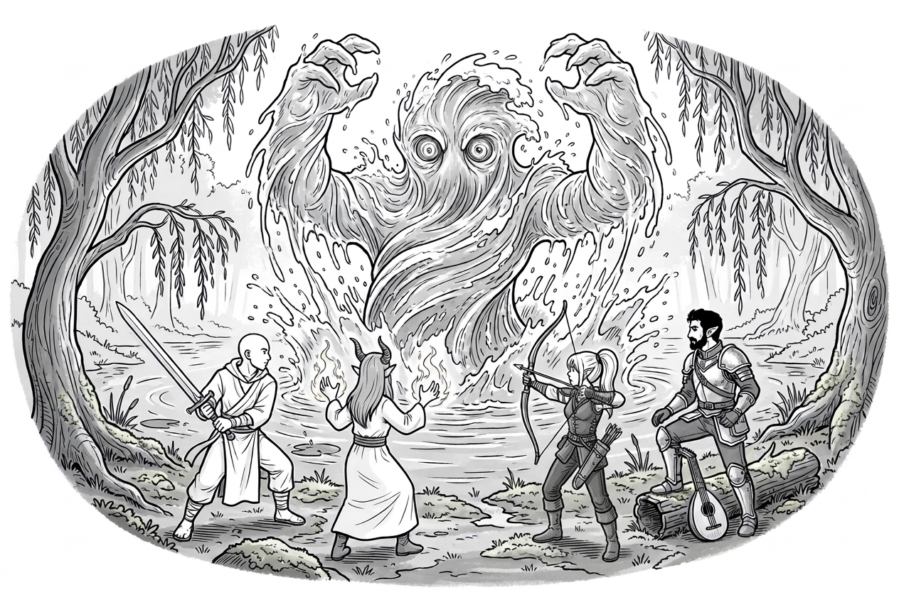

# Chapter 2: Sinking Inn

By late afternoon, the heroes arrived in the charming hillside village of Tuathair. Everything in the town was built for halflings and gnomes—which meant lots of ducking beneath signposts for everyone.

Right in the middle of Main Street, they saw the problem for themselves. The remnants of three different buildings—a market stall, a second-hand shop, and a tavern—had collapsed into deep, crumbling sinkholes in the dirt! The only thing that remained of the tavern was its sign, sticking up just out of the hole. It read "*The Giant Pint*."

A cheerful halfling with a big white apron trotted over to greet them. "Careful near the edge, tall folks! I'm Hormunt. That used to be my inn down in that hole." He pointed proudly across the street to a freshly painted building with an even bigger sign. "So I opened a new one. Welcome to *The Gianter Pint*! Mayor Deddwoc is waiting to meet you inside."

Ducking through the low front doorway of *The Gianter Pint*, the Keepers found Mayor Deddwoc—a round-faced gnome wearing a formal velvet sash—poring over a village map at a corner table while Hormunt hurried over with mugs of spiced apple cider. "Thank goodness the High Queen sent help!" Mayor Deddwoc exclaimed, dabbing his forehead with a handkerchief. "It started three weeks ago at the western edge of town. First, Berbalin's fruit stall dropped straight into the dirt. A week later, Turbin's second-hand shop went down, and two days ago, Hormunt's old tavern sank right after breakfast! I'm certain all these holes share a common cause, but none of us have the faintest idea where to start looking."

"And that's not the only strange thing," Hormunt chimed in, setting down the cider mugs. "Right around the time the first hole opened up, the lake in the woods west of town turned sour and bubbly. Our fishers haven't caught a single fish out there in weeks, and the brush has grown so thick you can barely walk the trail!"

The Keepers promised to investigate at first light and spent the night at *The Gianter Pint*—though Szeth's feet hung two feet off the end of his halfling-sized bed. The next morning, Hormunt served a towering platter of warm, golden, buttery breakfast biscuits.

Aknemeia took one bite and her golden eyes went wide with joy. "Oh, these are amazing! Szeth, try one! These are a hundred times better than those rocks we ate on the ship!"

Szeth nodded in agreement as he stuffed two biscuits into his pockets for later. "While we eat," Eryneth said, looking out the window toward the thick woods west of town, "notice how the sinkholes form a straight line? They started at the western edge of the village. And Hormunt mentioned the lake in the western woods turned foul a few weeks ago."

"Then the western lake is where we will find our culprit," Caryndal declared, strumming a heroic chord on his lute.

The woods west of Tuathair quickly grew tangled and dark. Before long, the solid ground turned into squelching mud, and a terrible smell—like rotten eggs and sour swamp water—filled the air. Stepping into a gloomy clearing, the heroes found a wide lake covered in bubbling green scum.

"Something isn't right," Eryneth whispered, nocking an arrow to her bow. "The water is moving against the wind."

Suddenly, the center of the lake bulged upward! With a deafening *SPLASH*, a massive wave of murky green water rose up like a living giant. Two swirling whirlpools formed where its eyes should be, and it swung a club-sized arm of crashing water straight at the heroes!

"Look out!" Szeth shouted, leaping forward with the heavy Beastslayer greatsword he had earned on Mintarn. He slashed through the watery arm, sending spray flying in every direction, but the water monster simply reformed and surged forward again, trying to sweep Caryndal off his feet. Caryndal yelped, scrambling back onto a mossy log.

"Let's see how it likes steam!" Aknemeia called out. She hurled twin bolts of bright orange fire straight into the creature's chest. The flames hit with a loud *HISS*, boiling away some of the monster's watery form, though less than Aknemeia had hoped.

Eryneth spotted the swirling core of magic spinning inside the creature's chest and loosed two silver-tipped arrows in rapid succession. *Splash! Splash!* The arrows tore straight through the creature, briefly disrupting its internal current. It wobbled a bit, but recovered quickly. Eryneth frowned.

"Any ideas, Caryndal?" Szeth yelled, bracing his boots in the mud and driving the flat of his greatsword against the surging wave to hold it back.

"Perhaps some theme music!" shouted Caryndal, leaping to the end of the log. He raised his lute high and struck a booming, magical chord. A shockwave of pure sound blasted across the clearing—*BOOOOM!* The living wave shattered into a million harmless droplets, raining down over the trees and splashing into the mud.

Aknemeia brushed a wet lock of hair out of her face, grinning. "Well, that wakes you up faster than biscuits."

"Look there," Eryneth said, pointing toward the far bank of the lake. Where the water level had dropped after the battle, a dark opening was now visible beneath the twisted roots of an ancient willow tree—a freshly dug tunnel leading deep underground.

Szeth, whose white robes were now more muck-colored, wiped the water from his sword and peered into the dark hole. "Whatever is digging under Tuathair is probably down there. Let's go."
